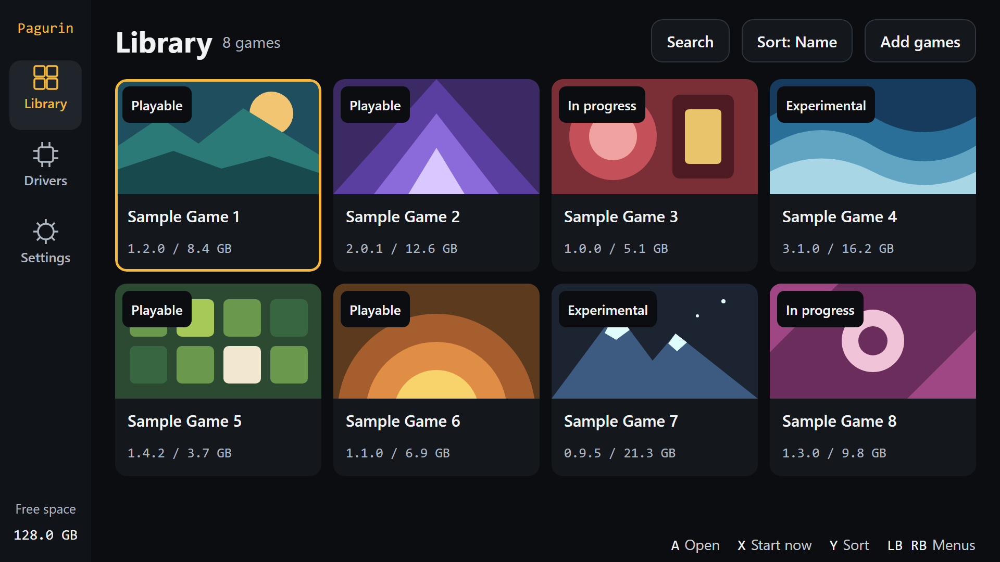

<h1 align="center"></h1>



Pagurin keeps your Android ports of games from other platforms in one app. You get a library, settings for each game, GPU drivers and save management, instead of a separate app per game.

Right now it runs ports made with [nx2android](https://github.com/shirai91/nx2android). It uses that project's output as it is and doesn't modify the engine. There are no games in this repository; you port your own.

Pagurin follows nx2android's main branch. Choosing a GPU driver needs a port made from it on 2026-11-03 or later; an older port still runs, on the system's driver.

## Features

- A library with search and sorting.
- Settings for each game: docked or handheld mode, the on-screen gamepad, rumble, the frame rate counter and the engine's performance switches. A game only shows the settings its own host reads.
- One game language for every game. A game that doesn't have it runs in English.
- GPU drivers picked per game. By default a game uses the driver its port was made with (`porter port --vulkan-driver`), or the system's if there isn't one. You can also pick the system's driver or one you added from a file.
- Save export, import and delete. Import also takes another app's save folder (an emulator's, say) or a zip.
- Games added from a PC with the import tool, or moved over from ports installed as their own apps.

## Install

Download `Pagurin-<version>.apk` from [Releases](../../releases) and install it. You need Android 10 or later on an arm64 device.

Updates install over the old version. Uninstalling deletes your games and saves unless you tell Android's uninstall dialog to keep the data.

## Add a game

Port the game on a PC with nx2android, which gives you `<App>.apk` and `<App>-data`. Connect the device with USB debugging on, download `pagurin-import.exe` from [Releases](../../releases), and run:

```
pagurin-import <App>.apk <App>-data [--serial <serial>]
```

If you have Python 3.9 or later, `python tools/pagurin_import.py` does the same thing on any system. Either way it needs `adb`, which it looks for on `PATH` and in the Android SDK's usual folder (`--adb` points it somewhere else).

Before sending anything, the tool checks that the port is complete, that the device is arm64 with a GPU that can read the game's textures, and that there's enough free space. Use `--check` to run only the checks. The game appears in the library once the transfer finishes. Running the tool again only sends what changed and removes files an older port of the game left behind.

To bring a game to a newer nx2android, port it again and run the tool with both new outputs. The APK and the data pack go together: the host only fits the game code (`mods/`) made in the same port, so there is no way to swap the APK alone.

A port contains code that runs inside Pagurin. Adding someone else's port is like installing an app from them, and that app can touch your games and saves. Port your own games, or only use ports from people you trust. Pagurin does ask before running code that changed since a game last started.

### From a port installed as an app

If you already have a port installed as its own app, Library › Add games › Add from installed apps moves it into Pagurin without a PC. The game data is moved rather than copied, the save comes along, and you can uninstall the old app afterwards.

Pagurin can't open another app's folders by itself, so this needs extra access. On AYN devices it uses the root service built into AYN's firmware, which works while SELinux is Permissive (the default). On other devices it uses [Shizuku](https://shizuku.rikka.app/): start Shizuku and allow Pagurin when asked. Through Shizuku the old app has to export its save first, so its host needs the save manager.

## Where things are

Pagurin keeps its files in `/sdcard/Android/data/io.github.zod701.pagurin/files/`. Each game has a folder in `games/<game ID>/` with the port's data, its host libraries, its settings (`pagurin.json`), the host's `settings.txt`, `env.txt` and `log.txt`, and exported saves in `saves/`. GPU drivers are in `drivers/` and shared by all games.

The live save is in the app's internal storage, not in that folder. The log tab can copy a game's log to `Download/Pagurin/`.

Every game keeps the host it was ported with, so a newer engine only reaches a game when you port it again.

## Build from source

You need the Android SDK (platform 36, CMake 3.22.1, NDK 27.3) and a JDK that Gradle 9.5 runs on. Point `sdk.dir` in `local.properties` at the SDK, then:

```
gradlew assembleRelease
```

The build signs with `%APPDATA%\Pagurin\keystore.p12` (`~/.config/Pagurin` on other systems) if it exists. The key alias is `pagurin`, and the passwords go in `keystore.properties` next to it or in `PAGURIN_STORE_PASSWORD` and `PAGURIN_KEY_PASSWORD`. Without it, a debug build uses the SDK's debug key. Android only installs updates from the same signer, so your own build won't install over a release.

To build the import tool, run `python tools/build_import_exe.py` on Windows with a python.org Python. It writes `out/pagurin-import.exe` and keeps its own PyInstaller in `out/import-exe/`.

## Notes

Only tested Pagurin on an AYN Thor (Android 13). Other devices may well work, but proper operation is not guaranteed.

Code was written with the help of an AI agent (Claude Opus).

## License

MIT. See [LICENSE](LICENSE) and [THIRD_PARTY_NOTICES.md](THIRD_PARTY_NOTICES.md).
