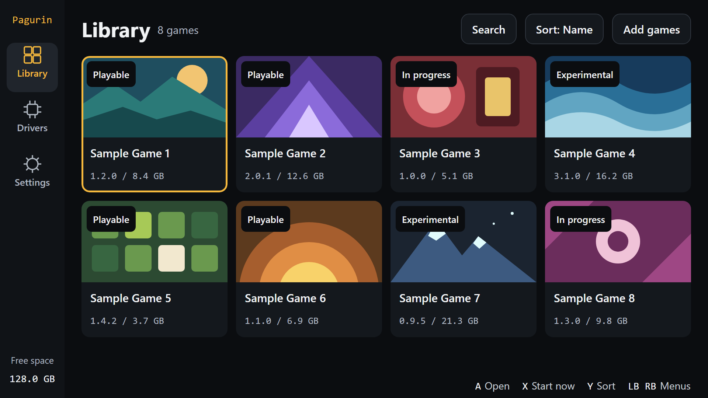

<h1 align="center"></h1>

<p align="center">One Android app for your game ports, instead of one app per game.</p>



Pagurin runs ports made with [nx2android](https://github.com/shirai91/nx2android) and gives them a shared library, per-game settings, GPU drivers and save management.

---

## Quick start

### 1. Install Pagurin

Download `Pagurin-<version>.apk` from [Releases](../../releases) and install it. It needs Android 10 or later on an arm64 device.

<details>
<summary>Build from source instead</summary>

You need the Android SDK (platform 36, CMake 3.22.1, NDK 27.3) and a JDK that Gradle 9.5 runs on. Set `sdk.dir` in `local.properties` to the SDK, then:

```sh
gradlew assembleRelease
```

The build signs with `%APPDATA%\Pagurin\keystore.p12` (`~/.config/Pagurin` elsewhere) when that file exists. The key alias is `pagurin`. The passwords go in `keystore.properties` beside it, or in `PAGURIN_STORE_PASSWORD` and `PAGURIN_KEY_PASSWORD`. Without a keystore, a debug build uses the SDK's debug key.

Android installs an update only from the same signer, so your own build won't install over a release.

To build the import tool too, run `python tools/build_import_exe.py` on Windows with a python.org Python. It writes `out/pagurin-import.exe` and keeps its own PyInstaller in `out/import-exe/`.

</details>

### 2. Port a game on your PC

Port the game with [nx2android](https://github.com/shirai91/nx2android). You get two things back: `<App>.apk` and the data pack `<App>-data`. Pagurin needs both.

### 3. Send it to the device

Turn on USB debugging, connect the device, download `pagurin-import.exe` from [Releases](../../releases) and run:

```sh
pagurin-import <App>.apk <App>-data [--serial <serial>]
```

The game shows up in the library when the transfer ends.

> [!TIP]
> Add `--check` to test the port and the device without sending anything. With Python 3.9 or later, `python tools/pagurin_import.py` works the same way on any system.

---

## Features

| Feature | What it does |
|---|---|
| Library | Every game in one place, with search and sorting. |
| Settings per game | Mode, gamepad, controllers and the engine's performance switches. See [Settings](#settings). |
| Game language | One language for all games. A game that lacks it runs in English. |
| GPU drivers | Add a driver from a file once, then pick it per game. |
| Saves | Export, import and delete. Import also takes another app's save folder (an emulator's, say) or a zip. |
| In-game menu | Pick the output the game's sound goes to, such as the speaker or Bluetooth headphones. |
| Performance Mode | Pagurin declares Android's Performance mode. In it, the game keeps its own frame rate instead of stepping down to 40 or 30. |

---

## Settings

Each game shows only the settings its own port understands. A setting the engine added later appears once you port the game again with a newer nx2android.

| Group | Settings |
|---|---|
| Graphics | GPU driver, docked or handheld |
| Input | On-screen gamepad and its opacity, rumble, face buttons by position or by label, the menu button, one player per controller or all of them as player 1 |
| Performance | Pass split, set split, the replay thread's cores, GPU turbo (off, on, or only while frames run late) |
| Display | Frame rate counter |
| System | Game language |

---

## Adding games

### From a PC

This is the path in the [Quick start](#quick-start). Before it sends anything, the import tool checks that the port is complete, that the device is arm64 with a GPU that reads the game's textures, and that there is room for it. It needs `adb`, which it looks for on `PATH` and in the Android SDK's usual folder. `--adb` points it elsewhere.

Running it again for the same game sends only what changed, and removes files an older port left behind.

> [!WARNING]
> A port is code that runs inside Pagurin, with access to your games and saves. Adding someone else's port is like installing an app from them. Port your own games, or use ports from people you trust. Pagurin asks before it runs a game whose code changed since its last start.

### From a port installed as its own app

Library › Add games › Add from installed apps moves an installed port into Pagurin without a PC. The game data moves instead of being copied, the save comes with it, and you can uninstall the old app afterwards.

Pagurin can't read another app's folders by itself, so this needs extra access:

| Device | What Pagurin uses |
|---|---|
| AYN | The root service built into AYN's firmware. It works while SELinux is Permissive, which is the default. |
| Others | [Shizuku](https://shizuku.rikka.app/). Start it and allow Pagurin when asked. The old app has to export its save first, so its port needs the save manager. |

---

## Updating

Pagurin updates install over the old version and keep your games.

A game keeps the engine it was ported with, so a newer nx2android reaches it only when you port it again. Then run the import tool with both new outputs. The APK and the data pack belong together: the engine in the APK only fits the game code from the same port, so the APK can't be swapped on its own.

> [!CAUTION]
> Uninstalling Pagurin deletes every game and save, unless you tell Android's uninstall dialog to keep the app's data.

<details>
<summary>Where Pagurin keeps its files</summary>

```text
/sdcard/Android/data/io.github.zod701.pagurin/files/
├── games/<game ID>/      the port's data and its host libraries
│   ├── pagurin.json      Pagurin's settings for the game
│   ├── settings.txt      the host's settings
│   ├── env.txt           the host's switches
│   ├── log.txt           the last run's log
│   └── saves/            exported saves
└── drivers/              GPU drivers, shared by all games
```

The save the game is using lives in the app's internal storage, not in this folder. The Log tab can copy a game's log to `Download/Pagurin/`.

</details>

---

## Notes

Pagurin is tested on one device so far: an AYN Thor on Android 13. Other devices may well work, but I can't promise they do.

The code was written with the help of an AI agent (Claude Opus).

---

## License

MIT. See [LICENSE](LICENSE) and [THIRD_PARTY_NOTICES.md](THIRD_PARTY_NOTICES.md).
